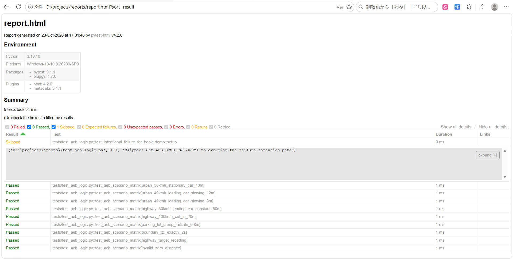

# AEB Decision Logic — Pytest Validation Mini-Project

[](https://github.com/Tommy356135/AEB-test/actions/workflows/pytest.yml)


一个用于练习**智能驾驶测试工程化**的最小闭环项目：用一个简化版 AEB 决策函数作为被测对象，演示如何用 `pytest` 组织场景矩阵、用 fixture 管理测试上下文、用 hook 保留失败现场，并通过 GitHub Actions 形成自动回归。

> **边界声明**：这不是量产 AEB 算法，也不做感知、执行器或车辆动力学仿真。被测函数只保留“从相对距离与相对速度判断是否制动”这一决策步骤，目的是把练习重心放在**测试组织与工程闭环**上，而不是算法标定。

---

## 项目背景

智能驾驶测试岗位的日常不是“写一个测试函数然后 assert”，而是：

- 把功能规范和场景需求**拆成可执行的用例矩阵**；
- 用 **fixture** 管理场景加载、日志记录、状态复位等前置/后置动作；
- 让失败用例**可定位、可回溯**，而不是只报一个“矩阵测试失败”；
- 把测试接入 **CI**，每次提交自动回归，失败现场作为产物保留。

---

## 项目结构

```
AEB-test/
├── .github/
│   └── workflows/
│       └── pytest.yml          # GitHub Actions：push / PR 自动跑回归并上传报告
├── conftest.py                 # 根目录 conftest，让 pytest 把项目根加入 sys.path
├── src/
│   └── aeb_logic.py            # 被测对象：简化版 AEB 决策函数（TTC + failsafe）
├── tests/
│   ├── conftest.py             # scenario_logger fixture + 失败感知 hook
│   └── test_aeb_logic.py       # 9 个语义化场景的参数化测试 + 1 个失败路径演示
├── reports/
│   └── .gitkeep                # 占位文件，确保 CI 上报告输出目录存在
├── data/                       # 预留：场景数据外部化（当前未使用）
├── .gitignore
└── README.md
```

---

## 快速开始

```bash
# 1. 克隆
git clone https://github.com/Tommy356135/AEB-test.git
cd AEB-test

# 2. 创建虚拟环境（Windows 示例，macOS/Linux 用 python3 -m venv venv && source venv/bin/activate）
python -m venv venv
.\venv\Scripts\Activate.ps1

# 3. 安装依赖
pip install pytest pytest-html

# 4. 运行测试
pytest tests/ -v

# 5. 生成 HTML 报告
pytest tests/ --html=reports/report.html --self-contained-html
```

**预期输出**：`9 passed, 1 skipped`，每个测试 ID 是语义化场景名，例如 `urban_30kmh_stationary_car_10m`、`failsafe_1.0m_boundary_brake`。

---

## 被测逻辑：为什么是 TTC + failsafe 双层判据

`src/aeb_logic.py` 的核心判断：

$$
TTC = \frac{D_{rel}}{V_{rel}}
$$

- **主判据**：`TTC < 2.0s` 时触发制动；
- **兜底判据**：相对距离 `≤ 1.0m` 时无条件制动，防止相对速度极小时 TTC 因分母过小而失真；
- **入口守卫**：距离非正、目标远离（相对速度 `≤ 0`）直接返回不触发。

阈值是**为便于手工验证而选的简化值**，不是量产标定。测试用例引用模块级常量 `TTC_THRESHOLD` / `FAILSAFE_DISTANCE`，阈值调整时测试自动跟随。

---

## 测试设计：四个可讲述的工程点

### 1. 参数化而不是 for 循环

9 个场景通过 `@pytest.mark.parametrize("scenario", SCENARIOS, ids=lambda s: s["id"])` 展开为**独立测试 ID**。循环只能产生一条测试结果，失败时无法定位具体工况；参数化让报告直接显示 `ttc_exactly_2s_boundary_no_brake` 这类语义化 ID。

### 2. 场景字典而不是裸参数元组

每个场景是自描述字典，携带 `id`、`description`、`ego_speed_kmh`、`relative_distance`、`relative_speed`、`expected`。扩展维度时只需往字典加 key，测试函数主体不变——这是“场景库条目”的最小结构。

### 3. fixture 管理测试上下文，hook 感知失败

`tests/conftest.py` 中的 `scenario_logger` fixture 用 `yield` 划分 setup / teardown：setup 记录场景名，teardown 检查 `request.node.rep_call.failed`，**仅当用例失败时打印完整场景日志**。`rep_call` 由 `pytest_runtest_makereport` hook 挂载。

### 4. 失败路径本身也被验证

`test_intentional_failure_for_hook_demo` 由环境变量 `AEB_DEMO_FAILURE=1` 控制，用来证明“失败留存逻辑确实生效”，而不是假设它生效：

```bash
# Windows PowerShell
$env:AEB_DEMO_FAILURE = "1"
pytest tests/ -v
Remove-Item Env:\AEB_DEMO_FAILURE
```

失败时会在 `Captured stdout teardown` 段落看到 `[SETUP]`、场景输入、`[TEARDOWN]` 三行日志；通过的用例不刷屏。

### 测试报告示例

本地运行 `pytest tests/ --html=reports/report.html --self-contained-html` 后的报告截图：


---

## CI：每次 push 自动回归

`.github/workflows/pytest.yml` 在 Ubuntu + Python 3.11 上执行：

1. checkout → setup-python → 安装依赖 → 运行 pytest → 上传 HTML 报告 artifact；
2. 上传步骤带 `if: always()`，**测试失败时报告仍然保留**；
3. `reports/.gitkeep` 占位，避免云端 checkout 后空目录导致 pytest-html 写文件失败。

每次 push 后可在 [Actions 页面](https://github.com/Tommy356135/AEB-test/actions) 查看运行结果，在 Artifacts 区域下载 `pytest-html-report`。

---

## 这个项目不是什么

- **不是** AEB 算法实现：不做感知融合、不做制动执行、不做车辆动力学仿真；
- **不是** 完整场景库：9 个场景是手工精选的高价值组合，用于演示结构，不追求覆盖率；
- **不是** 功能安全验证：没有 ISO 26262 / SOTIF 的完整流程，只是测试工程化的练习载体。

真实智驾测试的场景矩阵是“自车速度 × 目标类型 × 相对运动方式 × 光照 × 天气 × 道路类型”的笛卡尔积，再按风险优先抽样。本项目的场景字典结构就是那个矩阵条目的最小形态。

---

## 可以继续扩展的方向

- 把 `SCENARIOS` 外置到 `data/scenarios.yaml`，用 `pytest_generate_tests` 动态加载；
- 增加 `target_type`、`lighting`、`weather` 字段，用生成函数从维度笛卡尔积产生组合并人工裁剪；
- 让 `should_brake` 返回分级决策（FCW / 预制动 / 紧急制动），测试断言从 bool 升级为枚举；
- 在 CI 中加 `pytest-xdist` 并行执行和覆盖率统计。

---

## License

MIT
